# Antigravity Preflight

Catch blockers and incomplete evidence before independent review.

Antigravity Preflight is a Codex skill for preparing a bounded Gemini advisory review, checking source coverage and exact citations, and recording a disposition for every finding. It supports **PLAN** reviews of proposed work and **DIFF** reviews of implemented changes.

**Full Gemini 4 Argon / High native support is now available in v0.3.0.** The owner-activated r15 runtime supports PLAN and DIFF reviews with deterministic source assembly, workspace integrity checks and recorded cleanup observations. Manual Gemini 3.8 Flash / High remains the default.

| Review route | Model | Status | Selection |
| --- | --- | --- | --- |
| Manual handoff | Gemini 3.8 Flash / High | Available; default | Manual packet and adjudication workflow |
| Native Flash | `gemini-3.8-flash-high` | Available; original runtime preserved | Six-file Flash package |
| Native Argon | `gemini-4-argon-high` | Available; qualified r15 runtime | `--runtime-profile argon-high`, effort `high`, `useG1Credits=true` |

Both native routes require applicable host qualification and task authorization. No automatic model calls, fallback, remediation loop or independent-review launch is configured.

## What it does

1. Freeze a self-contained packet with named sources, hashes, project rules and review questions.
2. Request one bounded advisory review, keeping incomplete evidence distinct from proven defects.
3. Check source/question coverage and exact snapshot-local quotations.
4. Have Codex verify each finding's factual premises and record accepted, rejected or unresolved findings.
5. Hand the exact final candidate and evidence to the project's separately commissioned independent reviewer.

A matching quotation proves text placement, not that a claim is true. A clean preflight does not authorize implementation, publication, deployment or merging, and does not replace independent review.

## Install the manual skill

Clone this repository, then copy `skills/antigravity-preflight` into a skill directory discovered by your Codex installation. For a typical user-level installation, run from the repository root:

```bash
mkdir -p ~/.codex/skills
test ! -e ~/.codex/skills/antigravity-preflight && cp -R skills/antigravity-preflight ~/.codex/skills/antigravity-preflight
```

The command refuses to overwrite an existing skill. Start a new Codex session and request:

> Use $antigravity-preflight to prepare a PLAN review of these named artifacts. Use Gemini 3.8 Flash / High, include source and question coverage, and prepare an adjudication record. Prepare the packet first; submit it only within my authorization.

For a native Argon review, retain the full repository checkout and request:

> Use $antigravity-preflight for a PLAN review with the qualified native Gemini 4 Argon / High route (`argon-high`, effort `high`, `useG1Credits=true`). Prepare the bounded packet and fresh seed first. Use the native route only within my task authorization and the host's qualification; adjudicate every finding before independent review.

The same route supports DIFF review of implemented changes. Follow the [Argon setup and execution runbook](docs/argon-high.md). Copying only the manual skill does not install the native runtimes.

Use the [packet template](skills/antigravity-preflight/references/packet-template.md), [manual handoff](skills/antigravity-preflight/references/manual-handoff.md), and [project profile template](skills/antigravity-preflight/references/project-profile.md). Keep your project's policy in its own repository.

## Try the local citation example

Python 3.10+ is required for the supplied tooling. From the repository root, choose a new output file:

```bash
python3 -B -I skills/antigravity-preflight/scripts/manual_citations.py render examples/plan/inventory.json /tmp/antigravity-numbered-sources.txt
python3 -B -I skills/antigravity-preflight/scripts/manual_citations.py check examples/plan/inventory.json examples/plan/citations.json
```

These commands call no provider. The example report is explicitly synthetic. See [the example walkthrough](examples/README.md).

## Native CLI route

Read [the runtime runbook](skills/antigravity-preflight/references/runtime.md) before attempting native use. It targets Linux, Bubblewrap, `xdg-dbus-proxy`, an authenticated Secret Service session, and the exact separately obtained Antigravity binary and metadata. The vendor binary and credentials are **not distributed**.

The source-host Flash qualification reached P1–P5 and owner activation. That record is scoped to frozen agy **1.3.6**, the exact six-file runner/profile package and finite fixtures. Installing this repository does not transfer that host qualification or authorize a live run. The exact seven-file r15 Argon runtime completed source-host qualification, independent Claude review and owner activation on October 19, 2026. Argon requires `useG1Credits=true`; observer development remains PARKED. See [Argon qualification and use](docs/argon-high.md).

See [qualification status and limits](docs/qualification.md), [runtime pins](qualification/runtime-pins.json), and [publication provenance](qualification/publication-provenance.json). The qualification summary reports retained source-host evidence; this publication does not claim a new independent native audit.

## Evidence at a glance


All figures above come from deterministic offline checks. They show the gates behave as specified; they say nothing yet about how well the model reviews. That claim needs the live trials in the [benchmark plan](docs/benchmark-plan.md).




That figure is a small pilot on the `claude-cli` route (Claude Opus 5.5), not a Gemini or workflow result: no false blockers and no fabricated citations, with one corpus family found to be flawed in adjudication. Read the [full write-up](benchmarks/counterfactual-pairs/results/pilot1-claude-opus-5-5-high/README.md) before quoting it.



Pilot 2 repeated this on the preregistered, harder [corpus v2](benchmarks/counterfactual-pairs/v2/README.md) (same model, route and prompt): the preregistered ordinal metric was 20/20 in both trials, no sound plan was ever blocked, and no citation was fabricated. The honest reading is that the corpus has reached its ceiling for this reviewer, and that sound plans were hedged 40% of the time. [Write-up](benchmarks/counterfactual-pairs/results/pilot2-v2-claude-opus-5-5-high/README.md).


The preregistered ablation ran the same 40 plans with a bare prompt. On the verdict-only metric the skill-style arm ordered 40 of 40 pairs and the bare arm 21 of 37, yet the bare reviewer **found and named the defect in all 15 of the twins it missed**, then ended `GO_WITH_CHANGES`; neither arm blocked a sound plan. So this shows the verdict line carried the signal in one arm and not the other, not that the bundle improved defect detection. [Write-up](benchmarks/counterfactual-pairs/results/ablation-bare-opus-5-5-high/README.md).

The amber rows in the fault matrix are documented limits: a verbatim quotation can still misstate its source, so Codex must check each finding's premise. See the [fault-injection harness](benchmarks/fault-injection/README.md).

## Offline validation

On Linux, run the release checks, 50 citation scenarios, and two fresh 332-case launcher qualification runs:

```bash
python3 -B -I tools/check_release.py
python3 -B -I tools/test_demonstrated_utility.py
python3 -B -I skills/antigravity-preflight/scripts/test_manual_citations.py
python3 -B -I benchmarks/fault-injection/run_faults.py --check
python3 -B -I benchmarks/plots/make_figures.py --check
python3 -B -I tools/qualify_offline.py /tmp/antigravity-two-fresh-runs
```

Use a new output directory outside the repository. The launcher controls use synthetic process/transport doubles: no real Antigravity binary, auth proxy, provider or model is called. Their result is offline repeatability evidence, not native containment qualification.

## Additional Argon validation

```bash
python3 -B -I tools/qualify_argon_offline.py /tmp/antigravity-argon-two-fresh-runs
```

This runs 732 synthetic normal/profile, integrity and timing controls twice, followed by 40 controls against the saved envelope. The historical 1,828-case source-host suite included private denial-driver controls excluded from this portable subset. See the [v0.3.0 release notes](docs/release-v0.3.0.md) and [review reconciliation](docs/reviews/2026-10-17-reconciliation.md).

## Project

- [Demonstrated utility](docs/demonstrated-utility.md) — eight LLM review failure modes and boundary invariants deterministically verified by preflight
- [Exploratory four-case plan audit](benchmarks/exploratory-plan-audit/README.md) — saved responses with corrected scoring and retrospective limitations
- [Benchmark plan](docs/benchmark-plan.md) — eight benchmarks, with the figure each one produces
- [Bare-prompt ablation arm](benchmarks/counterfactual-pairs/ablation/README.md) — preregistered test of the skill-style bundle against a plain request on corpus v2; run once, with a verdict-calibration finding
- [Third arm: bare plus defined verdicts](benchmarks/counterfactual-pairs/ablation/defined/README.md) — preregistered test of whether defining the verdicts closes the verdict gap; not yet run
- [Ablation results](benchmarks/counterfactual-pairs/results/ablation-bare-opus-5-5-high/README.md) — bare prompt against skill-style prompt: 21/37 against 40/40 on the verdict metric, but the defects were found; platform interruptions and a mixed-model observation documented
- [Pilot 2 results](benchmarks/counterfactual-pairs/results/pilot2-v2-claude-opus-5-5-high/README.md) — corpus v2, Claude Opus 5.5, two trials: 20/20 on the preregistered primary metric, a ceiling effect, with adjudication
- [Pilot 1 results](benchmarks/counterfactual-pairs/results/pilot1-claude-opus-5-5-high/README.md) — Claude Opus 5.5 via the Claude CLI, two trials, with adjudication and a corpus defect found
- [Counterfactual-pair corpus v2](benchmarks/counterfactual-pairs/v2/README.md) — 40 harder cases, preregistered metrics, audited sound plans; no model run yet
- [Counterfactual-pair corpus v1](benchmarks/counterfactual-pairs/README.md) — frozen blind pilot inputs and scorer; no model run yet
- [Fault-injection harness](benchmarks/fault-injection/README.md) — 19 single-fault variants against the citation checker
- [Two proposed skill tests](docs/testing-next.md)
- [Architecture](docs/architecture.md)
- [Release notes](CHANGELOG.md)
- [Contributing](CONTRIBUTING.md)
- [Security and reporting limits](SECURITY.md)

MIT licensed. Antigravity and Gemini are third-party products; this is an independent community project and does not distribute or license those products.
