# Ablation: bare prompt against the skill-style prompt, corpus v2, Claude Opus 5.5

The preregistered [bare-prompt arm](../../ablation/README.md), run through [run_pilot_claude.py](../../run_pilot_claude.py) with `--arm bare`, compared with [pilot 2](../pilot2-v2-claude-opus-5-5-high/README.md) as the skill-style arm. **Claude model, `claude-cli` route, one corpus. It says nothing about Gemini, the skill's citation check or adjudication step, or any single component of the prompt bundle.** Nothing here is a general accuracy rate.

## What was found, in four sentences

On the preregistered verdict-only metric the skill-style arm is far ahead: it ordered 40 of 40 pairs and the bare arm 21 of 37, with 16 units favouring the skill-style arm and none favouring the bare arm. The preregistered hypothesis that the skill-style arm would block sound plans less often is **not supported**, because neither arm blocked a single one (0 of 40 and 0 of 39). Reading the bare reports shows why the verdict metric is so lopsided: in all 15 missed defect twins the bare reviewer **found and named the planted defect**, in 13 under a "blocking" or "critical" heading, and then ended with `GO_WITH_CHANGES`. So this result shows that, in the skill-style arm, the verdict line carried the defect signal, and it does **not** show that the skill-style bundle made the reviewer find defects better. The likely reason is structural: there the verdict follows from severity-labelled findings, while the bare arm's `GO` / `GO_WITH_CHANGES` / `NO_GO` is a free-standing choice with no definitions.

## Run identity and integrity

| | |
| --- | --- |
| Arm / route / model / effort | `bare` / `claude-cli` / `claude-opus-5-5` / `high`, the same as pilot 2 |
| Claude Code version | 2.1.306, the same as pilot 2 (comparability check: same model, effort and version) |
| Trials | 2 of 40 cases, one tool-free turn per case, no retries |
| Cost / time | $2.78 ($1.38 and $1.40); about 17 to 18 s per case, against about 12 s for the skill-style arm |
| Technical stops | 3 of 80 recorded, plus 1 more under the documented rule (below) |
| Evidence | [trial1](trial1/), [trial2](trial2/) (ledgers and unmodified reports), [analysis.json](analysis.json), [adjudication.json](adjudication.json), [human-reading.json](human-reading.json), [observation-details.json](observation-details.json), [verify.json](verify.json), the orchestrator's [metadata](orchestrator-metadata.json) and [original verify output](orchestrator-verify.json) |

The orchestrator's verification and mine, both using the checks as they were at run time, found **0 failures**: every saved request matches the frozen bare prompt and corpus, every report hash matches, the stamp and the pinned manifests are right. The checks have since been tightened (below), and the stricter verifier flags one observation on this evidence, correctly.

## What went wrong in the run, and what it was not

**The platform interrupted some bare reviews.** Four bare observations had a safety interruption (`safety_stops` of 1 or 2, two turns), all in the `output_bytes` family: that is 4 of the family's 8 bare observations. Across pilot 1 (48 observations) and the skill-style arm of pilot 2 (80), there were none. The cause is unknown; only the pattern is known.
- In three of them the reply was withheld, and the second turn is an apology ("My previous reply was interrupted and withheld, so I won't repeat that review"). The driver recorded these as `UNPARSEABLE_REPORT:NO_VERDICT_LINE`. **They are not instruction-following failures**: the reviewer produced no review. They are counted as stops, as preregistered, and the preregistered missing-verdict-line figure (3 of 80) must not be read as an instruction-following rate.
- The fourth (trial 2, `P-704166`) was interrupted twice and finished on a different model: `claude-opus-4-8` produced 1,882 of the turn's output tokens against 494 from `claude-opus-5-5`. My driver accepted it because it only required the requested model to appear among the served models, although the brief said a differing served model is a stop. That check is now strict, a safety interruption is its own named stop, and the verifier enforces both. Everything is analysed in **two views**, written down in [adjudication.json](adjudication.json) before any bare metric was computed: the as-run ledger (headline) and a view with this one observation treated as the stop it should have been. No conclusion below depends on which view is used.

**Two deviations from the brief.** The spend cap was $5.00 per case, not about $0.50; it never bound (largest case $0.0756, mean $0.0348). The run was on a different machine from pilot 2; the CLI version is the same, but pilot 2's binary hash was not recorded, so "the same binary" cannot be claimed.

## Preregistered results

Verdict-only metrics, identical for both arms. Wilson 95% intervals; the two trials are not independent samples. As-run ledger; the documented-rule view differs only where noted.

| | Skill-style (pilot 2) | Bare |
| --- | --- | --- |
| **Primary: ordinal pair discrimination** | **40/40** (0.91–1.00) | **21/37** (0.41–0.71) |
| Sound plans blocked (`NO_GO`) | 0/40 (0.00–0.09) | 0/39 (0.00–0.09) |
| Sound plans judged clean (`GO`) | 24/40 (0.45–0.74) | 7/39 (0.09–0.33) |
| Sound plans hedged (`GO_WITH_CHANGES`) | 16/40 (0.26–0.55) | 32/39 (0.67–0.91) |
| Changed twin judged correctly by verdict | 40/40 (0.91–1.00) | 23/38 (0.45–0.74) |
| Verdict identical across trials | 38/40 (0.84–0.99) | 29/40 (0.57–0.84) |
| Mechanism keyword rubric, among `NO_GO` defect twins | 36/36 | 19/19 |
| Technical stops | 0 | 3 |

**Paired comparison on matched units** (a pair in a trial, both twins with a verdict in both arms):

| View | Matched units | Both counted | Skill-style only | Bare only | Exact sign test |
| --- | --- | --- | --- | --- | --- |
| As run, all pairs | 37 | 21 | 16 | 0 | p < 0.0001 |
| As run, excluding caller/callee | 33 | 21 | 12 | 0 | p = 0.0005 |
| Documented rule, all pairs | 36 | 20 | 16 | 0 | p < 0.0001 |
| Documented rule, excluding caller/callee | 32 | 20 | 12 | 0 | p = 0.0005 |

Where the 16 units fall: runtime budget 4, caller/callee 4, migration order 3, absent vs null 2, unit mismatch 2, required coverage 1. The four runtime-budget units are the **limit the preregistration documented**: when a reviewer hedges on the sound plan, the uncertainty twin's correct `GO_WITH_CHANGES` leaves nothing to order. Caller/callee is the pair adjudicated in pilot 2 as having a text-visible gap in its sound plan.

**Hypotheses, stated in advance.** (1) The skill-style arm blocks sound plans less often: **not supported**, 0 against 0. (2) The skill-style arm orders more pairs: **supported on the verdict-only metric**, with the interpretation below.

## Human reading, as preregistered

Every missed defect twin (15, verdict not `NO_GO`) was read; no bare sound plan was blocked, so there were none of those to read. The classification is in [human-reading.json](human-reading.json). Reading coverage was uneven and is stated there: 7 reports in full, 7 for their first 2,300 characters (the finding and its mechanism), and the mixed-model one by its opening and ending.
- **All 15 named the planted mechanism**, correctly: the NOT NULL constraint run before the backfill; `main()` left catching `None` while `load_config` now raises; null and absent both written as 0; a report built from changed sources only; `timeout=5` read as 5 ms; three 700-byte values against a 1,500-byte cap that aborts the release.
- **13 of 15 called it blocking or critical** ("Blocking issue: the step order guarantees failure ... This failure is certain, not a risk"; "Critical defect: the plan iterates over the wrong set"). One said "Main issue ... a regression ... safe to proceed once `main()` is updated", and the mixed-model report said "the core arithmetic doesn't work".
- All 15 ended `VERDICT: GO_WITH_CHANGES`. The reports suggest the bare reviewer read that verdict as "go ahead once the required fix is made" (several end "with those changes, the plan is sound"). In the skill-style arm the machine summary ties the verdict to severity-labelled findings, so a verified `BLOCKER` finding yields `BLOCKERS_FOUND`; the bare prompt gives the three verdicts no definitions and no link to findings.
- The sound-plan reviews say things like "Timing does not block this plan" and "The core design is sound", then list recommended changes. They were hedged by the verdict scale, not alarmed.
- A sample of correct `NO_GO` twins had complete, correct reasoning.

**Exploratory, defined after reading, not preregistered:** counting reports whose headings call an issue blocking or critical gives roughly 31 of 34 defect twins against 2 of 39 sound plans (after removing one false positive of the heuristic). The two sound-plan hits are the migration plan, where the reviewer called "NOT NULL on `shipped_at`" a blocking concern; that rests on the column's name, not the packet text, and is the corpus weakness already noted in pilot 2. This is a keyword heuristic written by the person who read the reports, and it cannot be read as a measured rate.

## What this does and does not show

- **Supported:** with a plain request and an undefined verdict scale, this model's verdict line did not separate defective plans from sound ones (21 of 37 pairs), while its prose did. With the skill-style prompt, the verdict line did (40 of 40). The bare reviewer was also less repeatable on the verdict (29 of 40 against 38 of 40).
- **Not supported:** that the skill-style bundle improves defect detection. In the 15 readable misses the defect was found. The preregistration warned that the verdict scales differ, and the reading confirms that this difference, not reasoning, drives most of the gap. Because the arms differ in many things at once (system prompt, contract wording, numbered view, output format, verdict vocabulary and its link to findings), the result cannot say which of them matters; the link between verdict and labelled findings, and the verdict definitions, are the obvious candidates.
- **Not tested:** the mechanical citation check and the adjudication step, which are the skill's other claims, and which a bare arm cannot exercise.
- **Caveats:** the skill-style arm is non-concurrent; the safety interruptions removed 3 observations from the bare arm; one corpus audited by Claude models; two trials of the same case are not independent.

## Next, if wanted

1. **A third arm, bare plus defined verdicts** (the bare prompt with one line saying what each of `GO`, `GO_WITH_CHANGES` and `NO_GO` means, for example that `NO_GO` means a defect that makes the plan fail or break a stated rule as written, and nothing else). It tests the vocabulary explanation directly and cheaply. If it closes the gap, the measurable advantage of the skill-style bundle in this design is the verdict definition and its coupling to findings. If it does not, something else in the bundle is working. Preregister it before running.
2. **Find out why `output_bytes` plans were interrupted in the bare arm.** Only a controlled rerun of those four plans would say whether it is reproducible, and the cause could be the plan content or the bare prompt. This also matters to anyone using this route.
3. **A concurrent skill-style arm**, to remove the non-concurrency caveat.
