# Ablation: defined verdicts plus one sentence on optional suggestions, corpus v2, Claude Opus 5.5

The preregistered [fourth arm](../../ablation/defined-go/PREREGISTRATION.md), run through [run_pilot_claude.py](../../run_pilot_claude.py) with `--arm defined-go`, compared with the [defined arm](../ablation-defined-opus-5-5-high/README.md), the [bare arm](../ablation-bare-opus-5-5-high/README.md) and [pilot 2](../pilot2-v2-claude-opus-5-5-high/README.md) as the skill-style arm. The arm is the defined arm plus **one sentence**: *Optional suggestions that only make a working plan more robust are not changes it needs; if that is all you have, the verdict is GO.* **Claude model, `claude-cli` route, one corpus. It says nothing about Gemini, the skill's citation check or adjudication step, or any single component of the prompt bundle.** Nothing here is a general accuracy rate.

**The sentence was written after the defined arm's result, on this same corpus, to fix the failure seen there** (the preregistration says so). The results below are therefore a check of the mechanism, not out-of-sample evidence.

## What was found, in five sentences

The sentence did what it was written to do: **every one of the 40 sound plans was judged `GO`** (the defined arm: 8 of 40; skill-style: 24 of 40; 32 units favour the sentence, none favour the defined arm), and all 36 defect twins still received `NO_GO`. The price is the preregistered risk: the reviewer now files an **unverified risk as an optional suggestion**, and 3 of the 4 uncertainty-twin observations (all in one family, runtime budget, where the correct verdict is `GO_WITH_CHANGES`) were judged `GO`, so those 3 pairs can no longer be ordered. By the **preregistered label this is "costs detection"**, because the guard (three or more matched units where the defined arm was right and this arm is not) is met exactly, with 3. What was lost is the uncertainty family, not the defect twins; on four observations that is a rough estimate of the cost, not a measurement of it. The strict metric is highest here (37 of 40) only because strict rewards clean sound plans, which the skill-style arm (24 of 40) and the defined arm (7 of 39) rarely produce.

## Run identity and integrity

| | |
| --- | --- |
| Arm / route / model / effort | `defined-go` / `claude-cli` / `claude-opus-5-5` / `high`, the same as the other arms |
| Claude Code version | 2.1.306, the same as all three earlier arms (comparability check: same model, effort and version) |
| Binary / cap / host | Complete this time ([orchestrator-identity.txt](orchestrator-identity.txt)): commit `d935c72` (the branch head when the run started), the four manifest hashes (matching the committed files), binary SHA-256 `520bc6c1…71cfe` (the same as the earlier arms), $5.00 per-case cap, host `john-laptop` (the same kernel string as the bare and defined arms) |
| Trials | 2 of 40 cases, one tool-free turn per case, no retries; 2026-10-21 18:46 to 18:54 and 19:30 to 19:39 PDT |
| Cost / time | $1.84 ($1.00 and $0.84), the cheapest arm; about 12 to 13 s per case, the same as the skill-style arm |
| Technical stops | **0 of 80**, no safety interruption, one turn each, `claude-opus-5-5` the only model with output tokens |
| Evidence | [trial1](trial1/), [trial2](trial2/) (ledgers and unmodified reports), [analysis-vs-defined.json](analysis-vs-defined.json), [analysis-vs-skill.json](analysis-vs-skill.json), the two `output_bytes`-excluded views ([defined](analysis-vs-defined-excl-output-bytes.json), [skill](analysis-vs-skill-excl-output-bytes.json)), [adjudication.json](adjudication.json) (written before any metric), [human-reading.json](human-reading.json), [observation-details.json](observation-details.json), [verify.json](verify.json) |

My strict verifier and the orchestrator's both report **0 failures** with identical figures. **The platform interruptions did not recur**: the case interrupted in the bare arm (both trials) and the defined arm (trial 2), `P-704166`, completed normally both times. Across arms the interruption tally is 4 of 80 (bare), 1 of 80 (defined), 0 of 80 (defined-go), and 0 of 128 for pilot 1 and the skill-style arm. That is consistent with the interruptions being tied to the bare-style prompt, and it is not an explanation: the cause is still unknown. Cost and per-case time were lower than in the other bare-style arms; that is an observation, not a result.

## Preregistered results

Verdict-only metrics, identical for all arms. Wilson 95% intervals; the two trials of a case are not independent samples.

| | Skill-style (pilot 2) | Bare | Defined | **Defined + sentence** |
| --- | --- | --- | --- | --- |
| **Sound plans judged clean (primary)** | 24/40 (0.45–0.74) | 7/39 (0.09–0.33) | 8/40 (0.10–0.35) | **40/40** (0.91–1.00) |
| Sound plans blocked (`NO_GO`) | 0/40 | 0/39 | 0/40 | 0/40 |
| Defect twins judged `NO_GO` | 36/36 (0.90–1.00) | 19/34 (0.40–0.71) | 35/35 (0.90–1.00) | 36/36 (0.90–1.00) |
| Changed twin judged correctly | 40/40 (0.91–1.00) | 23/38 (0.45–0.74) | 39/39 (0.91–1.00) | **37/40** (0.80–0.97) |
| Ordinal pair discrimination | 40/40 (0.91–1.00) | 21/37 (0.41–0.71) | 35/39 (0.76–0.96) | 37/40 (0.80–0.97) |
| Strict pair discrimination (sound twin clean, changed twin right) | 24/40 (0.45–0.74) | 2/37 | 7/39 (0.09–0.33) | **37/40** (0.80–0.97) |
| Verdict follows finding | 36/36 | 19/34 | 35/35 | 36/36 |
| Verdict identical across trials | 38/40 | 29/40 | 37/40 | 39/40 (0.87–1.00) |
| Technical stops | 0 | 3 | 1 | 0 |

**Paired comparisons on matched units** (exact two-sided sign test; first arm named first):

| Comparison | View | Matched units | Both | Only first | Only second | p |
| --- | --- | --- | --- | --- | --- | --- |
| Sound plan clean, defined vs defined + sentence | All pairs | 40 | 8 | 0 | **32** | < 0.0001 |
| | Excluding caller/callee | 36 | 8 | 0 | 28 | < 0.0001 |
| | Excluding `output_bytes` | 36 | 5 | 0 | 31 | < 0.0001 |
| Changed twin correct, defined vs defined + sentence | All pairs | 39 | 36 | **3** | 0 | 0.25 |
| | Excluding caller/callee or `output_bytes` | 35 or 36 | 32 or 33 | 3 | 0 | 0.25 |
| Defect twin blocked, defined vs defined + sentence | All pairs | 35 | 35 | 0 | 0 | 1.0 |
| Ordinal pairs, defined vs defined + sentence | All pairs | 39 | 35 | 0 | 1 | 1.0 |
| Sound plan clean, skill-style vs defined + sentence | All pairs | 40 | 24 | skill 0 | sentence 16 | < 0.0001 |
| Strict pairs, skill-style vs defined + sentence | All pairs | 40 | 21 | skill 3 | sentence 16 | 0.0044 |
| Ordinal pairs, skill-style vs defined + sentence | All pairs | 40 | 37 | skill 3 | sentence 0 | 0.25 |

The 3 changed-twin units, the 3 ordinal units that skill-style wins and the 3 strict units that skill-style wins are the same three observations: runtime-budget uncertainty twins judged `GO` where the other arms said `GO_WITH_CHANGES`.

**Hypotheses, stated in advance.** (1) The sentence makes more sound plans clean than the defined arm: **supported**, 40 against 8. (2) It does so without lowering the share of defect twins that receive `NO_GO`: **supported** for defect twins (36 of 36 against 35 of 35), **not supported** for the wider guard that also counts uncertainty twins. (3) It is closer to the skill-style arm on sound-plan cleanliness: it **overshoots** it (16 units favour the sentence, none favour skill-style).

**Preregistered outcome label: costs detection.** The label is applied mechanically to all pairs, in the preregistered order: three matched units lost the correct verdict, which is the guard's threshold. No excluded view changes it (`caller_callee` or `output_bytes` excluded: still 3). Had the guard not applied, the sound-plan rule would have given "closes the sound-plan gap" (p < 0.0001, no unit favouring skill-style on sound-plan cleanliness). I do not relabel it.

## Human reading, as preregistered

The reading rule is in [human-reading.json](human-reading.json). There were no missed defect twins and no blocked sound plans to read, and no sound plan was still hedged, so the sample of still-hedged plans was empty. The reading was of the 3 false-clean twins, a sample of newly clean sound plans and two correct defect twins.
- **All 3 false-clean twins are the same kind.** Each names the gap (about 22 MB/s required, throughput unmeasured) and dismisses it as covered by the plan's own cancel-and-report rule, filing "benchmark first" under optional suggestions: "this is a real unknown, but the plan already handles it"; "the unmeasured throughput is a risk, but the cancel-and-report rule already contains it"; "a risk rather than a defect". None misses the gap. This is the risk the preregistration named.
- **It is a defensible reading of the plan's own rule**, which is the uncomfortable part. A cancelled run is a designed outcome, so "the plan works as written" is not wrong. The oracle's expectation, that an unmeasured throughput deserves a flagged change, is met by the skill-style arm 4 of 4 times. Which one the verdict scale should encode is a design question this experiment cannot settle.
- **The newly clean sound plans were read as intended**: the reviewer traces each plan to its rule, concludes it works, and lists its former hedges under "Optional suggestions: none of these is needed for the plan to work". The caller/callee sound plan, adjudicated in pilot 2 as having a text-visible gap (nothing tests `main()`), got the gap named and called optional, so a `GO` there is the sentence working as written and arguably a miss. The primary result does not depend on that pair (36 of 36 clean without it).
- Two correct defect twins (migration order, unit mismatch) had complete reasoning: the reviewer still separates the required fix from the robustness suggestions.
- Coverage was partial and is stated in the file. Judged by one reader, who wrote the corpus and the sentence.

## What this does and does not show

- **Supported:** the remaining sound-plan gap of the defined arm was also vocabulary: one sentence about when `GO` applies moved sound plans from 8 of 40 to 40 of 40 clean without costing a defect twin. Together with the defined arm, the two prompt additions (five lines and one sentence) reproduce and exceed, on the verdict-only metrics, what the skill-style bundle's verdict achieves on sound plans and defect twins.
- **Not supported:** that the sentence is free. It also converts unverified risks into `GO`. With four uncertainty observations in one family the size of that cost is not measured, only shown to exist (3 of 4). A corpus with many more evidence-gap cases would say whether it is a corner case or the general behaviour.
- **Not shown:** that the sentence generalizes (it was written against this corpus), that another wording would avoid the cost (a version that separates "unverified risk" from "optional robustness" would be a fifth arm tuned on the same corpus, and should be tested on a held-out one), or anything about the skill's mechanical citation check and adjudication step, which a bare prompt cannot exercise. The skill-style arm's verdict stays more conservative on sound plans (clean 24 of 40) for a reason that this experiment suggests is partly the same one: its hedging may be doing real work on evidence gaps that the `GO` sentence removes.
- **Caveats:** all four arms were run at different times, not concurrently; one model; one corpus audited by Claude models; two trials of one case are not independent; the sentence was written after seeing the defined result.

## Next, if wanted

1. **A held-out corpus (v3)** with many more evidence-gap (uncertainty) twins, different wording and a different author or generator seed, preregistered, and then the defined, defined-go and skill-style arms run on it concurrently. Everything on v2 has now been used to tune or label the arms, and this is the only way to say whether the sentence's cost is small or large.
2. **A fifth arm only after that**, if the cost is real: a sentence that separates "an unverified risk the plan does not address" from "optional robustness", preregistered on v3, not on v2.
3. **A concurrent skill-style arm** on v2 or v3, to remove the non-concurrency caveat shared by all four.
4. **A controlled rerun of the four `output_bytes` plans**, now that the interruptions occurred in two arms (bare 4, defined 1) and not in the other three.
