# Ablation: bare prompt plus defined verdicts, corpus v2, Claude Opus 5.5

The preregistered [third arm](../../ablation/defined/PREREGISTRATION.md), run through [run_pilot_claude.py](../../run_pilot_claude.py) with `--arm defined`, compared with the [bare arm](../ablation-bare-opus-5-5-high/README.md) and with [pilot 2](../pilot2-v2-claude-opus-5-5-high/README.md) as the skill-style arm. The arm is the bare prompt plus **one five-line block saying what `GO`, `GO_WITH_CHANGES` and `NO_GO` mean**. **Claude model, `claude-cli` route, one corpus. It says nothing about Gemini, the skill's citation check or adjudication step, or any single component of the prompt bundle.** Nothing here is a general accuracy rate.

## What was found, in five sentences

Defining the verdicts did most of the work: on the preregistered verdict-only metric the defined arm ordered **35 of 39** pairs against the bare arm's 21 of 37, with 12 units favouring the defined arm and none favouring the bare arm (p = 0.0005). Every one of its 35 defect twins that produced a verdict received `NO_GO` (the bare arm's figure was 19 of 34), no sound plan was blocked, and the reviews found the same defects the bare reviews had. By the **preregistered label this is "partly closes the gap"**, because 4 units still favour the skill-style arm over the defined arm (the label's limit is 3) and 0 favour the defined arm (p = 0.125). All 4 are in one family, runtime budget, which is the limit the preregistration documented: when a reviewer hedges on the sound plan, the uncertainty twin's correct `GO_WITH_CHANGES` leaves nothing to order. **The defined arm did not catch up on sound plans:** it judged 8 of 40 clean against the skill-style arm's 24 of 40 (16 units favour skill-style, 0 favour defined), exactly as often as the bare arm (7 of 39), so the strict metric that needs a sound plan to be clean while its twin is blocked stays low (4 of 20 and 3 of 19 against 13 of 20 and 11 of 20).

## Run identity and integrity

| | |
| --- | --- |
| Arm / route / model / effort | `defined` / `claude-cli` / `claude-opus-5-5` / `high`, the same as pilot 2 and the bare arm |
| Claude Code version | 2.1.306, the same as both earlier arms (comparability check: same model, effort and version) |
| Trials | 2 of 40 cases, one tool-free turn per case, no retries |
| Cost / time | $2.33 total; about 15 s per case, against about 17 s for the bare arm and 12 s for the skill-style arm |
| Technical stops | 1 of 80 recorded (`SAFETY_INTERRUPTED:2`), and no reclassification was needed |
| Evidence | [trial1](trial1/), [trial2](trial2/) (ledgers and unmodified reports), [analysis-vs-bare.json](analysis-vs-bare.json), [analysis-vs-skill.json](analysis-vs-skill.json), the two `output_bytes`-excluded views ([bare](analysis-vs-bare-excl-output-bytes.json), [skill](analysis-vs-skill-excl-output-bytes.json)), [adjudication.json](adjudication.json), [human-reading.json](human-reading.json), [observation-details.json](observation-details.json), [verify.json](verify.json) |

My strict verifier (`verify_run.py --arm defined`: requests byte-for-byte against the frozen prompt and corpus, report hashes, stamp and arm-manifest hash, every served model equal to the request, no safety-interrupted observation recorded as a verdict) reports **0 failures on both trials**.

**Run identity, supplied after the fact.** The returned archive did not contain the binary hash, cap, host or times. The owner later pasted the orchestrator's hand-back ([orchestrator-reported-identity.json](orchestrator-reported-identity.json); not checkable against the archive): commit `506c25d`, the three manifest hashes (matching the committed files), binary `/home/john/.local/bin/claude` with SHA-256 `520bc6c1…71cfe`, the same hash recorded for the bare arm and (in a later report) pilot 2, a $5.00 per-case cap, the same host as the bare arm (`john-laptop`, same kernel string), and the trials at 2026-10-21 17:31 to 17:41 and 17:44 to 17:54 PDT. So the three arms very probably differ only in the prompt bundle. The orchestrator's own verification output was still not returned; [verify.json](verify.json) is my run on the archive.

**One safety interruption, in the family that was interrupted before.** Trial 2, `P-704166` (`output_bytes`, wording A, defect twin) had `safety_stops` = 2, two turns, and `claude-opus-4-8` beside the requested model: the same signature as the one mixed-model observation in the bare arm, and the same case that was interrupted in the bare arm in both trials. The driver, as fixed after the bare run, recorded it as a stop. The tally across arms is 1 of 80 here, 4 of 80 in the bare arm and 0 of 128 in pilot 1 and the skill-style arm. Whatever the cause is, it is rarer with the verdict definitions than without them, and it remains unexplained. The primary result is reported with and without `output_bytes`; the paired comparison is the same either way, because none of the 12 or 4 discordant units is in that family.

## Preregistered results

Verdict-only metrics, identical for all three arms. Wilson 95% intervals; the two trials of a case are not independent samples. Technical stops are removed, not counted as verdicts.

| | Skill-style (pilot 2) | Bare | Defined |
| --- | --- | --- | --- |
| **Primary: ordinal pair discrimination** | **40/40** (0.91–1.00) | **21/37** (0.41–0.71) | **35/39** (0.76–0.96) |
| Sound plans blocked (`NO_GO`) | 0/40 (0.00–0.09) | 0/39 (0.00–0.09) | 0/40 (0.00–0.09) |
| Sound plans judged clean (`GO`) | 24/40 (0.45–0.74) | 7/39 (0.09–0.33) | 8/40 (0.10–0.35) |
| Sound plans hedged (`GO_WITH_CHANGES`) | 16/40 (0.26–0.55) | 32/39 (0.67–0.91) | 32/40 (0.65–0.90) |
| Changed twin judged correctly by verdict | 40/40 (0.91–1.00) | 23/38 (0.45–0.74) | 39/39 (0.91–1.00) |
| Strict pair discrimination, trial 1 / trial 2 | 13/20 and 11/20 | 1/18 and 1/19 | 4/20 and 3/19 |
| Verdict identical across trials | 38/40 (0.84–0.99) | 29/40 (0.57–0.84) | 37/40 (0.80–0.97) |
| Verdict follows finding (defect twins whose report matches the rubric that got `NO_GO`) | 36/36 (0.90–1.00) | 19/34 (0.40–0.71) | 35/35 (0.90–1.00) |
| Mechanism rubric, among `NO_GO` defect twins | 36/36 | 19/19 | 35/35 |
| Technical stops | 0 | 3 | 1 |

**Paired comparisons on matched units** (a pair in a trial, both twins with a verdict in both arms; exact two-sided sign test):

| Comparison | View | Matched units | Both counted | Only first | Only second | p |
| --- | --- | --- | --- | --- | --- | --- |
| Defined against bare | All pairs | 36 | 20 | bare 0 | defined 12 | 0.0005 |
| | Excluding caller/callee | 32 | 20 | bare 0 | defined 8 | 0.0078 |
| | Excluding `output_bytes` | 36 | 20 | bare 0 | defined 12 | 0.0005 |
| Defined against skill-style | All pairs | 39 | 35 | skill 4 | defined 0 | 0.125 |
| | Excluding caller/callee | 35 | 31 | skill 4 | defined 0 | 0.125 |
| | Excluding `output_bytes` | 39 | 35 | skill 4 | defined 0 | 0.125 |
| Sound plan clean, defined against skill-style | All pairs | 40 | 8 | skill 16 | defined 0 | < 0.0001 |
| Sound plan clean, defined against bare | All pairs | 39 | 5 | bare 2 | defined 2 | 1.0 |
| Changed twin judged correctly, defined against bare | All pairs | 37 | 23 | bare 0 | defined 14 | 0.0001 |

The 12 units that moved from bare to defined are in: caller/callee 4, migration order 3, absent vs null 2, unit mismatch 2, required coverage 1. The 4 units that still favour the skill-style arm are all **runtime budget**: the sound plan is hedged `GO_WITH_CHANGES`, and the uncertainty twin's correct `GO_WITH_CHANGES` then leaves nothing to order.

**Hypotheses, stated in advance.** (1) The defined arm orders more pairs than the bare arm: **supported**, 12 against 0. (2) The defined arm is closer to the skill-style arm than the bare arm is: **supported** on the primary metric (16 units favoured the skill-style arm over the bare arm; 4 do over the defined arm), but not on sound-plan cleanliness, where the defined arm is no closer than the bare arm (16 units favour skill-style, 0 favour defined).

**Preregistered outcome label: partly closes the gap.** The defined arm beats the bare arm at p < 0.05 and more than 3 units (4) still favour the skill-style arm. The label is applied mechanically to all pairs, as preregistered. The preregistration also noted that these descriptive labels are not claims of equivalence: with about 40 matched units, "no significant difference from the skill-style arm" (p = 0.125) is weak evidence of equality.

## Human reading, as preregistered

The preregistered reading rule had two parts, and **both are empty**: every defined-arm defect twin that did not receive `NO_GO` (none: all 35 that produced a verdict did, and the 4 uncertainty twins received `GO_WITH_CHANGES`, the preregistered correct verdict) and every sound plan that received `NO_GO` (none, 0 of 40; this was the risk of defining `NO_GO`). So there were no misses and no false blockers to classify. The classification is in [human-reading.json](human-reading.json).

A sample of six correct twins was read for reasoning (first 1,250 characters, which hold the finding and its mechanism), plus two sound-plan reports. Five of the six sampled twins are ones the bare arm had missed. The defect found is the same as in the bare arm; the difference is that the reviewer now applies the supplied definition explicitly and the verdict follows (for example, "which meets the NO_GO definition: 'the plan as written will fail'"). The migration sound plan, which in the bare arm drew "Blocking concerns" about `NOT NULL` on `shipped_at`, now files the same concern under recommended changes ("Does it work as written? Yes ... Nothing in the plan breaks a rule it states"). The runtime-budget twin shows the reasoning behind the 4 remaining units: the reviewer derives the 22 to 23 MB/s requirement, notes that no measurement exists, and argues in two sections why the plan is neither `NO_GO` (nothing shows it will fail) nor `GO` (it may fail every night).

Reading coverage was partial, as in the bare arm, and is stated in the file: eight reports were read for their opening; all others were checked only by their verdict and the keyword rubric. Judged by one reader, the benchmark's author, who wrote the corpus.

**Exploratory, not preregistered:** the blocking-or-critical heading heuristic from the bare analysis, reused unchanged, counts 25 of 35 defect twins and 0 of 40 sound plans for the defined arm (bare: 31 of 34 and 2 of 39). The twin count fell because the defined reviews use different headings, not because they found less (all 35 named the mechanism and all received `NO_GO`). The heuristic is not comparable across prose styles and is not used for any conclusion.

## What this does and does not show

- **Supported:** in this design, a plain request with a five-line definition of the verdicts is enough to make this model's verdict line follow its findings: 35 of 35 defect twins whose report named the mechanism received `NO_GO`, against 19 of 34 without the definitions, with no sound plan blocked. The gap on defect twins is closed. So the earlier result ("the skill-style arm detects defects far better on the verdict metric") is largely a **verdict-calibration** result, not a detection one, and the five lines carry most of it. Verdict repeatability also recovered (37 of 40 against 29 of 40).
- **Not closed:** sound plans. The defined arm hedges them exactly as the bare arm does (clean 8 of 40 against 7 of 39) and the skill-style arm does not (24 of 40). This is the part of the bundle the definitions do not reproduce, and it is why the strict metric stays low. The plausible reason, which this experiment cannot confirm, is that the skill-style prompt asks for severity-labelled findings, so a plan with only minor findings gets `NO_BLOCKERS_FOUND`, while the five-line block still lets any recommended improvement tip the verdict to `GO_WITH_CHANGES` (its definition says so: "should be improved").
- **Not shown:** that the definitions are necessary (the skill-style arm differs in other ways), that a differently worded definition behaves the same (the author wrote this one and it is close to the skill's idea of a blocker), or anything about the skill's mechanical citation check and adjudication step, which a bare prompt cannot exercise.
- **Caveats:** the three arms were run at different times, not concurrently; the corpus was audited by Claude models; one model; two trials of one case are not independent; the identity gaps listed above.

## Next, if wanted

1. **A controlled rerun of the four `output_bytes` plans** in the bare and defined arms, plus the skill-style arm for contrast, to find out whether the safety interruptions reproduce and which part of the prompt or plan triggers them.
2. **A fourth arm aimed at sound plans:** the defined arm with the one extra sentence that optional suggestions are not a reason to withhold `GO`. It tests directly whether the remaining clean-plan gap is vocabulary too. [Built and preregistered](../../ablation/defined-go/README.md) after this result, with the wording chosen after seeing it (stated there); not yet run.
3. **A concurrent skill-style arm**, to remove the non-concurrency caveat shared by all three comparisons.
4. **A new corpus (v3)** with a different author and different wording, so the conclusions do not depend on one audited set.
