# Pilot: counterfactual pairs, Gemini 3.8 Flash High through the native runtime

Two trials of the frozen 24-case corpus v1 ([../../README.md](../../README.md)), run through [run_pilot.py](../../run_pilot.py) on the qualified `flash-high` native route (the `agy` CLI inside a Bubblewrap sandbox with a private home and a filtered credential proxy), against the same cases that [pilot 1](../pilot1-claude-opus-5-5-high/README.md) ran on Claude Opus 5.5. **This is the first Gemini evidence in the benchmark. It is one corpus with one defective family, two non-independent trials, and a model that is requested and configured but not attested as the one that served each turn.** Nothing here is a general accuracy rate, and nothing about the skill's workflow value (benchmarks A and F in the [benchmark plan](../../../../docs/benchmark-plan.md)).

## What was found, in five sentences

On the preregistered strict metric the Gemini reviewer discriminated **8 of 12 pairs in both trials** once four format stops are re-read under a rule written before scoring (as run, with those four observations removed: 5 of 9 and 7 of 11), against Claude Opus 5.5's 9 of 12 and 8 of 12, with **zero false blockers, zero hedged sound plans (Claude hedged 7 of 24) and zero unsupported VERIFIED findings**. Excluding the output-byte family (a corpus defect found in pilot 1), the ordinal reading is **20 of 20 pair-observations for both routes**, and the strict metric is 8 of 10 in both Gemini trials against Claude's 9 of 10 and 8 of 10. The one systematic difference is on required coverage: Gemini wrote a RISK (`CHANGES_RECOMMENDED`) on both twins in both trials, saying the diff's contents are not in the snapshot, where Claude wrote a VERIFIED blocker, so those two pairs fail the strict metric (which needs a blocker on the decisive line) and pass the ordinal one. Four reports (all on defect twins) ended with a correct, VERIFIED blocker and an exact quotation but wrote the snapshot's label `S01:3` in the line field where a digit was asked, and the strict parser stopped them; the same field held a bare digit in the other 19 finding lines. The route is roughly 10 to 15 times slower than the Claude route (a median of about 105 to 115 seconds and a mean of about 170 seconds per case, about 67 minutes per trial, against about 11 seconds per case), and its served model cannot be attested.

## Run identity and integrity

| | |
| --- | --- |
| Route / profile | `runtime/flash-high`, profile `flash-high`, effort `high` (from launcher configuration) |
| Model | `gemini-3.8-flash-high` **as requested and configured**; the receipts say `servedAttestation: UNAVAILABLE` |
| Binary | `/home/john/.local/bin/agy` 1.4.1, SHA-256 `16e228cb…f7508` |
| Corpus | v1, 24 cases, manifest SHA-256 `9885c1cf…2e46` (the committed manifest) |
| Commit | `d935c72339b5…` as reported by the orchestrator (see below) |
| Host | `john-laptop`, Linux Mint 22.3, kernel 7.0.0-38 |
| Trials | 2, 24 cases each, one tool-free native turn per case, zero retries; 2026-10-22 15:56 to 17:02 and 17:16 to 18:23 PDT |
| Time | 4,006 s and 4,067 s per trial (per case: minimum 22 s, median 117 s and 103 s, maximum 353 s and 464 s) |
| Technical stops | 4 of 48, all `UNPARSEABLE_REPORT:MALFORMED_FINDING` |
| Evidence | [trial1](trial1/), [trial2](trial2/) (ledgers, unmodified reports, CLI receipts), [adjudication.json](adjudication.json) (written before any score), [score-as-run.json](score-as-run.json), [score-documented-rule.json](score-documented-rule.json), the re-read ledgers `responses-documented-rule.jsonl`, the orchestrator's [identity record](orchestrator-reported-identity.json), [hand-back report](HANDOFF-REPORT.md) and [README](ORCHESTRATOR-README.md) |

**Checked by me, independently of the orchestrator.** Both ledgers have 24 rows in the frozen submission order; every ledger report hash equals the SHA-256 of the committed report (48 of 48); re-parsing every report with the committed parser reproduces every ledger row and every stop; all 48 receipts say `REPORT_RECEIVED_PENDING_ADJUDICATION` with no failure, zero retries and one native invocation; `run_pilot.py`, `score.py`, the packets, oracle and prompt are byte-identical between the run's commit and the current branch. **Not re-run by me:** process reaping and sandbox isolation (the orchestrator's receipts say all 48 attempts were reaped and no private home or socket directory remained), and the offline qualification (664 cases, two passes, per the orchestrator).

**Two discrepancies, neither affecting the scores.** (1) The orchestrator's identity record names commit `d935c72` with the subject "Use python3 -B -I across all benchmark and runtime commands", but that commit's subject in this repository is "Record the defined arm's orchestrator identity report"; the hash is taken as the identity (every file the run uses is unchanged since it) and the subject is recorded as wrong. (2) The orchestrator pushed its own evidence to this branch (commit `b67acc3`, 101 files, all under this directory) although its brief said not to push or commit results.

## Preregistered score, as run and under the documented rule

The scorer and its definitions were frozen before the run. Wilson 95% intervals; the two trials are not independent samples.

| | Gemini, as run | Gemini, documented rule | Claude (pilot 1) |
| --- | --- | --- | --- |
| Observations judged (rest are stops) | 21 and 23 of 24 | 24 and 24 of 24 | 24 and 24 |
| **Pairs discriminated** (sound plan clean **and** twin correct), trial 1 / trial 2 | 5/9 (0.27–0.81), 7/11 (0.35–0.85) | **8/12 (0.39–0.86), 8/12 (0.39–0.86)** | 9/12 (0.47–0.91), 8/12 (0.39–0.86) |
| False blockers on sound plans | 0/12, 0/12 | 0/12, 0/12 | 0/12, 0/12 |
| Sound plans hedged (`CHANGES_RECOMMENDED`) | 0/12, 0/12 | 0/12, 0/12 | 3 and 4 of 12 |
| Changed twin judged correctly | 5/9, 7/11 | 8/12, 8/12 | 10/12, 10/12 |
| Unsupported VERIFIED findings (gate: zero) | 0, 0 | 0, 0 | 0, 0 |
| Outcome class identical across trials | 22/24 (0.74–0.98) | 24/24 (0.86–1.00) | 23/24 (0.80–0.99) |
| Verdict identical across trials | 21/24 | 23/24 | 23/24 |

Per family, pairs discriminated out of 2 per trial (trial 1 / trial 2), Gemini documented rule against Claude: absent vs null 2/2, 2/2 against 2/2, 2/2; caller/callee 2/2, 2/2 against 1/2, 0/2; ownership 2/2, 2/2 against 2/2, 2/2; runtime budget 2/2, 2/2 against 2/2, 2/2; required coverage **0/2, 0/2** against 2/2, 2/2; output byte limit 0/2, 0/2 against 0/2, 0/2.

**Ordinal reading** (the changed twin judged strictly more severely than its sound twin; the evidence-gap twin must not be a blocker), a key added to the scorer after pilot 1 and recomputed for it with the current scorer, which still reproduces pilot 1's committed strict score exactly: Gemini 12/12 and 11/12 over all families, Claude 10/12 and 10/12. **Excluding the output-byte family** (adjudicated in pilot 1 as a corpus defect, carried over here on the packet text and shown beside, never instead of, the all-pairs numbers): **10/10 and 10/10 for both routes**; strict 8/10 and 8/10 for Gemini and 9/10 and 8/10 for Claude.

## The four stops, and why the headline is as-run

All four are complete reports with `ASSESSMENT: BLOCKERS_FOUND` and a finding `BLOCKER | VERIFIED | S01:3 | <exact quotation of line 3>`: P-97610e in both trials, P-6b8046 and P-7a8a51 in trial 1. The snapshot shows its lines as `[S01:n]`, and the model copied the label into the line field. The strict parser rejects it. That is a technical stop and, by the corpus rules, is neither a verdict nor a wrong judgment, so the as-run column removes it from every denominator. The documented rule (`S01:<n>` is read as line n, nothing else relaxed, written in the adjudication file before any score and implemented in [reparse_lenient.py](../../reparse_lenient.py) from the hash-checked reports) turns them into the four blockers they obviously were, and is the column the figures use. Neither view changes any conclusion except the denominator: the two families the stops touch (ownership, caller/callee) are 2/2 under the rule and 0/0 to 2/2 as run. What the stops show about the driver is that its line-number field is brittle against a model that follows the snapshot's own labelling; a later driver version could accept the label, but changing it after the run would be a new version.

## Human reading, as the preregistered procedure for v1 asks

All 48 reports were read in full, after the adjudication file was written and before any score was computed. The reader is the corpus's author; the verdict table of the orchestrator's README had been seen, no score had.
- **Mechanisms and citations.** Every blocker named the planted mechanism and cited the decisive line with an exact quotation: the null/absent collapse, the tuple against `window + 3600`, the run-identifier rule against "deletes all of them". None invented evidence, and none promoted missing evidence to a blocker.
- **Required coverage.** Both twins, both wordings, both trials: `CHANGES_RECOMMENDED` with an UNVERIFIED RISK on line 3, stating that the diff's contents are not in the snapshot, so it cannot be shown that fewer than four sources changed. That follows the review contract's "do not treat missing evidence as a proven defect" more literally than Claude did. It is a defensible reading of the text, and it is the whole of the strict-metric gap between the routes.
- **Output byte limit.** The twins drew `CHANGES_RECOMMENDED` (three of four observations) with a RISK about unbounded values, and one `NO_BLOCKERS_FOUND` (P-398544, trial 2). The sound plans were judged clean all four times: this reviewer did not raise the gaps (unbounded keys, escaping, bytes against characters) that the pilot 1 reviewer raised, so it neither confirms nor refutes the corpus defect; the exclusion stands on the packet text.
- **Runtime budget.** The twins got `CHANGES_RECOMMENDED` with the unmeasured throughput named and the required rate computed (about 22 MB/s), and the sound plans were judged clean with the measured 55 MB/s cited. That is the behaviour the benchmark wants.
- **Caller/callee and ownership sound plans** were judged clean: no hedge for an unverified remark, which is what the strict metric rewards and what Claude did not do.

## What this does and does not show

- **Supported:** on this corpus, the Gemini 3.8 Flash High reviewer followed the single changed fact about as well as Claude Opus 5.5 did (ordinal 20 of 20 on the five valid families for both), blocked no sound plan, hedged none, and invented no evidence. Its strict-metric deficit is one family where it was more cautious than Claude, and four format stops.
- **A real driver finding:** 4 of 23 finding lines used the snapshot's label in the line field. A route whose format suffix shows `[S01:n]` and asks for "the snapshot line number" invites it.
- **Not shown:** the served model (unattested); anything about the harder corpus v2 or the held-out v3, where this ceiling would not hold; the skill's own claims (packet discipline, citation check, adjudication, an independent reviewer downstream); the Defined-verdict and sentence ablations, which were run on the Claude route only and have no Gemini counterpart.
- **Caveats:** one corpus with one defective family; two non-independent trials; the two routes were run at different times and with different prompt wrappers (the Gemini route embeds the numbered snapshot in the prompt and adds a fixed question and format block); the strict metric rewards a sound plan judged fully clean, which a more cautious reviewer fails; a sample of one model per route.

## Next, if wanted

1. **The same reviewer on corpus v2, and then v3.** v2 and v3 are where the ceiling breaks and where the verdict-calibration question lives; both need the Gemini driver's `--corpus` path (it exists) and about 110 and 180 minutes per trial at this route's speed. Preregister v3's Gemini run before running it.
2. **A line-label tolerance in the driver**, as a new driver version, so the next Gemini run does not lose observations to it; or change the format suffix to say "digits only".
3. **The verdict-definition and sentence arms on the Gemini route.** The Claude-route findings (verdict calibration, the cost of the optional-suggestions sentence) say nothing about Gemini; this route is the skill's actual target, and its verdicts follow its findings more closely than the bare Claude arm's did, so the question may look different there.
