# Held-out corpus v3 on Gemini 3.8 Flash High through the native runtime

Two trials of the frozen 64-case corpus v3 ([../../v3/README.md](../../v3/README.md)), run through [run_gemini_v3.py](../../run_gemini_v3.py) on the qualified `flash-high` native route (the `agy` CLI inside a Bubblewrap sandbox with a private home and a filtered credential proxy), as [the preregistration](../../v3-run-gemini/PREREGISTRATION.md) fixes it. **This is the skill's actual target reviewer on a corpus written after its weaknesses were known, with eight evidence-gap families and no absorbing fallbacks. It is one model as requested and configured (the served model is not attested), one route, one corpus authored and audited by Claude, and two non-independent trials. Nothing here is a general accuracy rate.**

## What was found, in five sentences

On the held-out corpus the reviewer called **61 of 63 sound plans Clean, blocked all 32 defect-twin observations and flagged all 32 evidence-gap-twin observations as Changes recommended**, each in every wording and in both trials, with no false blocker, no waved-through twin, no overclaimed twin and zero unsupported VERIFIED findings. The strict pair metric was **31 of 31 in trial 1 and 30 of 32 in trial 2**; the only misses are two sound plans (of different families, in trial 2) that it hedged with a non-blocking RISK, and the same plans were Clean in the other trial and wording. The reviewer was no weaker on the five families that need inference across lines (20 of 20 blocked) than on the three direct ones (12 of 12), so the preregistered expectation that inference defects would be missed more often was not borne out. This is a ceiling result: it shows that the reviewer reads a stated unknown as a risk and a stated contradiction as a blocker, and it cannot rank this reviewer against a stronger one or show how it behaves when the unknown is not written down. One observation was a runtime stop (an error step, no report) on a sound plan and is excluded, not rerun.

## Run identity and integrity

| | |
| --- | --- |
| Route / profile | `runtime/flash-high`, no runtime profile, effort `high` (from launcher configuration) |
| Model | `gemini-3.8-flash-high` **as requested and configured**; every receipt says `servedAttestation: UNAVAILABLE` |
| Binary | `agy` 1.4.1, SHA-256 `16e228cb…f7508` (the binary of the v1 pilot) |
| Corpus | v3, 64 cases, manifest SHA-256 `1ad68528…4202` |
| Run manifest | `d853fee3…01ff5d2` ([v3-run-gemini/manifest.json](../../v3-run-gemini/manifest.json)), stamped on every ledger row |
| Run commit | `58a7b38219b6930b232695842292c10918011809` (the orchestrator's record) |
| Host | `john-laptop`, Linux Mint 22.3, kernel 7.0.0-38 |
| Trials | 2 × 64 cases, one tool-free native turn each, zero retries; trial 1 2026-10-23 07:05 to 10:35 PDT, trial 2 13:12 to 16:48 PDT |
| Time | 12,483 s and 12,695 s of case time (about 3.5 hours per trial): per case a median of 116 s and 128 s, a maximum of 486 s and 531 s |
| Technical stops | 1 of 128: `RUNTIME_STOP:UNQUALIFIED_STEP` on Q-497363 (a sound plan), trial 1 |
| Snapshot labels read as line numbers | 11 of 67 FINDING lines (3 in trial 1, 8 in trial 2), the preregistered tolerance |
| Evidence | [trial1](trial1/), [trial2](trial2/) (ledgers, unmodified reports, CLI receipts), [adjudication.json](adjudication.json) (written before any metric), [score.json](score.json), [analysis.json](analysis.json), [human-reading.json](human-reading.json), [orchestrator-identity.txt](orchestrator-identity.txt), [ORCHESTRATOR-README.md](ORCHESTRATOR-README.md), [qualification/](qualification/) |

**Checked by me, independently of the orchestrator**, with the committed `verify_gemini_run.py` on a directory reassembled from the returned archive: both ledgers have 64 rows in the frozen order; every row carries the run's stamp; all 127 reports hash to their ledger rows and receipts; re-parsing every report with the committed tolerant parser reproduces every ledger row and label flag and finds no other stop; all 127 clean receipts are `REPORT_RECEIVED_PENDING_ADJUDICATION` with the pinned model and effort, zero retries, one proxy and one native invocation, both processes reaped, the private home and socket directory removed, the pinned binary hash, and a delivered prompt of exactly the expected stream-json frame length. No failure in either trial.

**Limits of that check.** The archive was hand-assembled, so it holds no per-case packets or CLI init files: the request is bound by the receipts' byte counts and the hashes in every row, not by comparing the prompt files. Reaping, sandbox isolation and the 664-case offline qualification are the orchestrator's records, not re-run here. The orchestrator's own log lists `PROMPT_DELIVERY` for every case of trial 1: that was the verifier's defect at the run commit (it compared against the bare prompt, not the stream-json frame), fixed afterwards and validated on the v1 pilot's receipts; the fixed verifier passes here. This time the orchestrator did not commit or push.

## The three primary rates, as run

Wilson 95% intervals; the two trials are not independent samples, so the pooled interval is wider in truth than it looks.

| Rate | Both trials | Trial 1 | Trial 2 |
| --- | --- | --- | --- |
| Sound plans judged `GO` | **61/63** (0.891–0.991) | 31/31 | 30/32 |
| Defect twins judged `NO_GO` | **32/32** (0.893–1.000) | 16/16 | 16/16 |
| Evidence-gap twins judged `GO_WITH_CHANGES` | **32/32** (0.893–1.000) | 16/16 | 16/16 |
| Strict pair discrimination (sound plan Clean **and** twin right) | **61/63** (0.891–0.991) | 31/31 (0.89–1.00) | 30/32 (0.80–0.98) |
| Ordered pair discrimination (twin judged more severely; gap twin not a blocker) | 61/63 | 31/31 | 30/32 |
| Sound plans blocked | 0/63 | 0/31 | 0/32 |
| Sound plans hedged | 2/63 | 0/31 | 2/32 |
| Evidence-gap twins `NO_GO` (overclaimed) / `GO` (waved through) | 0/32 / 0/32 | | |
| Gap named, rubric recall (all 32 evidence-gap twins) / named but dismissed | 32/32 / 0 | | |
| Verdict follows the finding | 32/32 | | |
| Verdict identical across trials (63 matched cases) | 61/63 | | |
| Unsupported VERIFIED findings (gate: zero) | **0** | 0 | 0 |

Per family, all 16 families have every twin right in every wording and trial. The two non-Clean sound plans are `unique_constraint` wording A and `storage_access` wording B, both in trial 2. The stopped observation is the `unique_constraint` wording B sound plan, trial 1, so that family has 3 sound plans judged and 2 of them Clean.

Not computed: a second documented-rule view (there is no format stop to re-read) and a bounding sensitivity for the stopped observation (not preregistered).

## The preregistered hypotheses

1. **Sound plans judged `GO` at a high rate: supported** (61 of 63; the v1 pilot, on easier plans, was 24 of 24). Neither miss is a blocker; both are non-blocking RISK findings the reading classifies as defensible (below).
2. **Defect twins blocked less often on the five inference families than on the three direct ones: not supported.** 20 of 20 against 12 of 12. The v1 pilot's systematic miss was a defect whose premise lies outside the snapshot (the contents of a diff); in v3 every defect is derivable from the snapshot's own lines, so the premise gap that produced that miss is absent by design.
3. **Evidence-gap twins judged `GO_WITH_CHANGES` at a high rate: supported** (32 of 32, none `GO`, none `NO_GO`).
4. **Reports name the unestablished fact: supported** (rubric 32 of 32; ten read in full, all named it and said what to establish).

## Human reading, as preregistered

Read after the scores, by the corpus author ([human-reading.json](human-reading.json) has the cases and the rule).

- **Nothing to read for the rates that matter:** no evidence-gap twin was not `GO_WITH_CHANGES` and no defect twin lacked `NO_GO`.
- **Both non-Clean sound plans were read in full.** `unique_constraint` A, trial 2: the duplicate query covered rows before release 4.9 and the code-path argument covers rows since, so the report recommended a full-table check; a defensible hedge on a plan whose own line 5 is an argument, not a query. `storage_access` B, trial 2: a single run with no retry, and a 1 KB write test that does not exercise a 30 GB write; non-blocking, and the report said why it is not a blocker. Both are hedges, neither a false blocker.
- **Ten evidence-gap twins** (every family at least once): each named the unestablished fact, quoted the line that states it, answered the fixed question with No, cited the rule that missing evidence is not a proven defect, and recommended a measurement or confirmation. None dismissed it, none promoted it, none invented evidence.
- **Five defect twins read beyond the preregistration** (the inference families): each named the planted mechanism and consequence (60 requests per second against a 50 ceiling; opposite lock order and a circular wait; a fresh idempotency key per retry; the day-5 root removal; a cache key without the tenant), not just the line.
- **Time followed the work:** sound plans a mean of 117 s, defect twins 178 s, evidence-gap twins 364 s. Descriptive only.

## What this does and does not show

- **Supported:** on a corpus built after the earlier pilots, with explicit evidence gaps and no fallback that absorbs them, the Gemini 3.8 Flash High reviewer through this route judged sound plans clean, blocked contradictions, and downgraded stated unknowns to RISK without calling them blockers or waving them through, invented no evidence, and did so consistently across two wordings and two trials. The v1 pilot's concern that this reviewer systematically misses a defect needing an outside premise is not tested here and is not refuted.
- **Not shown:** that it finds an unknown that the plan does not write down. In all eight evidence-gap families the twin states the gap in one explicit sentence ("has not been measured", "nobody has checked"), and the sound plan states the matching fact, so a reviewer that reacts to such sentences passes whether or not it reasons about them. Likewise every defect is derivable from the snapshot's own lines. The corpus shares the author's blind spots (Claude wrote and audited it), plan notes are short (7 or 8 lines), and a 100% result at this size cannot distinguish a very good reviewer from a good one: the lower interval bounds are 0.89.
- **Nothing here about** the skill's citation check, adjudication or packet discipline beyond the scored VERIFIED findings; Argon; real repositories; the served model; or the Claude route on this corpus, which has not been run.
- **Caveats:** one model as requested; 11 of 67 finding lines used the preregistered label tolerance; one stop on a sound plan; two trials of the same cases; the reviewer was run once per case per trial with the same frozen prompt and no ablation.

## Next, if wanted

1. **A corpus that removes the ceiling** (a v4): evidence gaps stated nowhere in the plan (the plan simply never says), defects needing a premise from outside the snapshot, longer plans, adversarial sound plans with a plausible but non-binding gap. This result says v3 cannot discriminate further for this reviewer.
2. **The Claude route on v3** (three arms, six runs, about $10), for the cross-route paired comparison the preregistration allows. The tooling is built; nothing has been run.
3. **Fold the evidence into the workflow benchmarks** (A and F in the [benchmark plan](../../../../docs/benchmark-plan.md)): this measures the reviewer's judgments, not whether the skill's workflow improves what an independent reviewer sees.
