# The skill-style prompt plus the optional-suggestions sentence, on corpus v3

Four runs of the frozen 64-case corpus v3 ([../../v3/README.md](../../v3/README.md)) through [run_pilot_claude.py](../../run_pilot_claude.py), as [the skill-go preregistration](../../v3-run-skill-go/PREREGISTRATION.md) fixes it: the new `skill-go` arm (the skill-style request with one line added, the `defined-go` sentence adapted to the skill-style vocabulary) in two trials, and an optional **concurrent control**, the unchanged `skill` arm, in two trials. **One model, one route (the Claude CLI, tools disabled, not the qualified native containment), one corpus written and audited by Claude, two non-independent trials per arm. The arm was designed after the three earlier v3 arms were read, so v3 is not held out for this question: this is a test of a stated prediction, not out-of-sample evidence. Nothing here is a general accuracy rate.**

## What was found, in five sentences

The sentence **cured the hedging**: the skill-style prompt judged 63 of 64 sound plans `GO` with it, against 35 of 64 for the concurrent control (28 matched units to 0), and the defect twins stayed blocked (32 of 32 in every arm). It did **not wave gaps through** (0 of 32 judged `GO`, against 1 for the plain-request sentence arm), so the cost the preregistration feared did not appear in that form. It appeared instead as **more overclaiming**: 14 of 32 evidence-gap twins were judged `NO_GO` against 7 in the control (8 units to 1, p = 0.039), and `GO_WITH_CHANGES` fell from 25 to 18 of 32; every report I read named the gap correctly and asked for the same check, and differed only in ruling it a blocker. Net, on the strict pair metric, `skill-go` is the best Claude arm yet (49 of 64, against 28 for the control, 42 for the plain-request sentence arm, 12 for the defined arm), and it keeps the evidence-gap twin better than the plain-request sentence arm (18 of 32 `GO_WITH_CHANGES` against 10, p = 0.02). The Gemini reviewer's 32 of 32 on the gap twins and 61 of 63 on sound plans, on a different route, remains out of reach for every Claude arm.

## Run identity and integrity

| | |
| --- | --- |
| Route / model | `claude-cli`, tools disabled, one `claude -p` turn per case, zero retries; `claude-opus-5-5` (requested and **served**, in all 256 CLI outputs), effort `high` |
| CLI | Claude Code 2.1.306, binary SHA-256 `520bc6c1…0cfe` (the binary of every earlier Claude-route arm) |
| Corpus / run manifest / arm manifest | v3 `1ad68528…4202` / `585b20e1…2376` (stamped on every ledger row) / `c4648609…acebb` |
| Run commit | `f74dad00bc13f9aad03c430c4c1f0665e70d5b31` (the head of this branch when the run was prepared) |
| Host | `john-laptop`, Linux Mint 22.3, kernel 7.0.0-38 |
| Order and times | the preregistered order with the control: run 1 `skill-go` trial 1 (2026-10-24 15:14 to 15:29 PDT), then, **after a gap of about five and a half hours**, run 2 `skill` trial 1 (20:54 to 21:11), run 3 `skill` trial 2 (21:25 to 21:41) and run 4 `skill-go` trial 2 (21:48 to 22:03) |
| Cost | **$8.36** (`skill-go` $2.09 and $2.08, control $2.44 and $1.76); the largest single case $0.061 against the $5 cap, which never bound |
| Technical stops | 0 of 256; zero safety interruptions, permission denials and error flags; one turn each |
| Evidence | per arm and trial: `responses.jsonl`, `reports/<case>.md` (unmodified); [raw-returned-archive.tar.gz](raw-returned-archive.tar.gz) (SHA-256 `c20b84ec0f3925e0643f28861298ddf070c670db45f5b99b9f2e15a1f46b0256`), the orchestrator's archive of the four runs byte for byte, which holds every per-case CLI output and saved request (unpack it and run `verify_run.py` on `work-<arm>`; a test does so); `verify.json` per arm; [adjudication.json](adjudication.json) (written before any metric); `score-skill-go.json`, `score-skill.json` (the control); [analysis.json](analysis.json) (skill-go against the control and `defined-go`), [analysis-vs-earlier-skill.json](analysis-vs-earlier-skill.json) (against the earlier skill ledgers), [analysis-control-vs-earlier.json](analysis-control-vs-earlier.json); [human-reading.json](human-reading.json); [orchestrator-identity.txt](orchestrator-identity.txt) |

**Checked by me, independently of the orchestrator**, with the committed `verify_run.py` on both arms' returned working directories under the skill-go run manifest: 64 rows per trial in the frozen order; every saved request equals what the frozen prompt and corpus produce (for `skill-go`, the skill-style request plus the one pinned line); every report hash matches its row; the run-manifest hash and arm stamps on every row; one served model; no stop. Both arms `failures: []`. The orchestrator did not commit, push or edit anything. **Deviation to know about:** run 1 ended five and a half hours before run 2 started (the preregistration fixed the order, not a maximum gap), so the control is less concurrent with `skill-go` trial 1 than with trial 2; the control and the earlier skill-style ledger of 2026-10-23 agree closely (below), so drift looks small on these metrics.

## The three primary rates, as run

Wilson 95% intervals; the two trials of a case are not independent. All 256 observations have a verdict. The primary comparison is the concurrent control.

| Rate | `skill-go` | `skill` control | `skill` earlier (v3 run) | `defined-go` earlier |
| --- | --- | --- | --- | --- |
| Sound plans `GO` (64) | **63** (0.917–0.997) | 35 (0.426–0.663) | 34 | 64 |
| Defect twins `NO_GO` (32) | 32 (0.893–1.000) | 32 | 32 | 32 |
| Evidence-gap twins `GO_WITH_CHANGES` (32) | 18 (0.393–0.718) | **25** (0.612–0.890) | 24 | 10 |
| …judged `NO_GO` (overclaimed) | 14 | 7 | 8 | 21 |
| …judged `GO` (waved through) | 0 | 0 | 0 | 1 |
| Strict pairs (64) | **49** (0.649–0.853) | 28 (0.323–0.559) | 26 | 42 |
| Ordered pairs (64) | **49** | 43 | 39 | 42 |
| Sound plans hedged / blocked | 1 / 0 | 29 / 0 | 30 / 0 | 0 / 0 |
| Verdict identical across trials (64 cases) | 59 | 58 | 58 | 60 |
| Cost | $4.16 | $4.19 | $4.81 | $4.21 |

Finding-level score (`score.py --corpus v3`), per trial: `skill-go` strict pairs 24/32 and 25/32, false blockers 0 and 0, hedged 1 and 0, **unsupported VERIFIED findings 0 and 0** (the preregistered gate); the control strict pairs 14/32 and 14/32, hedged 15 and 14, unsupported VERIFIED findings 0 and 0.

Paired comparisons on matched (case, trial) units, exact two-sided sign test (units favouring the first arm only, the second only; p):
- `skill-go` against the **control**: sound plans `GO` 28 / 0, p < 0.0001; defect twins 0 / 0; evidence-gap `GO_WITH_CHANGES` 1 / 8 in the control's favour, p = 0.039; evidence-gap `NO_GO` (more under `skill-go`) 8 / 1, p = 0.039; strict 25 / 4, p < 0.0001; ordered 10 / 4, p = 0.18.
- `skill-go` against the **earlier** skill ledgers: sound plans `GO` 29 / 0, p < 0.0001; evidence-gap `GO_WITH_CHANGES` 1 / 7, p = 0.070; evidence-gap `NO_GO` 7 / 1, p = 0.070; strict 25 / 2, p < 0.0001; ordered 12 / 2, p = 0.013.
- `skill-go` against `defined-go`: sound plans `GO` 0 / 1, p = 1; evidence-gap `GO_WITH_CHANGES` 9 / 1 in `skill-go`'s favour, p = 0.022; strict 9 / 2, p = 0.065.
- **Control against the earlier skill ledgers** (a measure of run-to-run and day-to-day difference): sound plans `GO` 5 / 6, p = 1; evidence-gap `GO_WITH_CHANGES` 1 / 2, p = 1; strict 5 / 7.

Per family, every defect twin was blocked in every run. `skill-go` judged every sound plan `GO` in every family except one observation of `unique_constraint`. On the evidence-gap families it held `storage_access`, `unique_constraint` and `capacity_headroom` (12 of 12 `GO_WITH_CHANGES`), and lost most of `rollback_window` (4 in the control, 1), `retry_idempotent` (4, 2), `payload_limit` (3, 2) and `rate_limit_quota` (2, 0); `upgrade_compat` was `NO_GO` in 3 of 4 under `skill-go` and 4 of 4 in the control.

## Preregistered labels and hypotheses

Labels (`labels()` in [analyze.py](../../v3-run-skill-go/analyze.py), fixed in advance), `skill-go` against the concurrent control: **sound-plan hedging: reduced**; **defect twins: held**; **evidence-gap twins: skill better** (on `GO_WITH_CHANGES`); **waves gaps through: does not**; **overclaiming: increased**; against `defined-go`: evidence-gap `GO_WITH_CHANGES` **skill-go better**, sound plans **no significant difference**. Against the earlier skill ledgers the same labels apply except evidence-gap twins (**no significant difference**) and overclaiming (**not detected**); the p-values are 0.07 and 0.07, on either side of the 0.05 rule, so the headline labels depend on which skill ledger is the baseline. They are descriptive.

1. **`skill-go` judges more sound plans `GO` than `skill`: supported** (63 against 35; 28 units to 0).
2. **It blocks defect twins as often: supported** (32 of 32).
3. **It judges fewer evidence-gap twins `GO_WITH_CHANGES` than `skill`: supported** (18 against 25, p = 0.039 against the control, 0.070 against the earlier ledger), **but not by the predicted mechanism**: none became `GO`; the loss went to `NO_GO`.
4. **It judges fewer evidence-gap twins `NO_GO` than `skill`: not supported, the opposite** (14 against 7, p = 0.039 against the control).

## Human reading, as preregistered

By the corpus author, who designed the arm and had seen the scores ([human-reading.json](human-reading.json)).

- **Nothing to read for the waved-through, missed-defect and blocked-sound readings:** none occurred.
- **The one remaining hedge** (`unique_constraint` B): a defensible RISK on the unevidenced "single code path" claim, no blocker.
- **Ten of the 14 overclaimed twins:** each names the gap and quotes the line that states it; nine say explicitly that they are not claiming the failure will happen ("no overrun is asserted here") and then rule a `BLOCKER | VERIFIED` because the plan admits it has no evidence and the stakes are hard or irreversible ("the blocker is narrower", "a release should not proceed under those conditions"). The `VERIFIED` label sits on the line that states the gap, which is why the gate is zero beside them. Under the review contract's rule that missing evidence is not a proven defect this is an overclaim; a reader could argue an admitted-unverified requirement with a penalty or an irreversible effect deserves a blocker, but the correct reports and the Gemini reviewer kept it at a risk. Each asks for the same check as the correct reports.
- **Ten of the 18 correct twins:** each names the gap and asks for a measurement or confirmation; eight add a sentence that echoes the added line ("a change the plan needs, not just extra robustness"). The sentence makes the reviewer decide whether a gap is optional or needed; for a stated unknown that decides the plan's success it concludes "needed", and the report then either stays at a risk (correct) or goes on to a blocker (the overclaim). That is a reading of the reports, not a measured mechanism.
- **Reproducibility:** seven twins were overclaimed in each trial, five of them the same cases (nine distinct cases), so the effect is largely a per-case disposition.

## What this does and does not show

- **Supported:** adding the one sentence to the skill-style prompt removes its hedging of sound plans (29 hedged in the control, 1 with the sentence), keeps every defect blocked, and never lets a stated unknown through as clean in 32 observations; it is the best Claude arm on the strict pair metric.
- **The trade-off it shows:** the same sentence moves about seven more of 32 evidence-gap twins from a risk to a blocker. Whether that is a cost depends on the corpus's reading that missing evidence is a risk, not a blocker; the skill's own contract says so, and the Gemini reviewer followed it on all 32, but a reviewer could defend the blocker.
- **Not shown:** that the sentence helps or hurts the Gemini route (not run, and that route sits at its ceiling here); that any of this transfers beyond a corpus where the unknown is stated in one sentence and the corpus author also designed the arm; that a different wording or position of the sentence would not do better (it would be a different arm, and would be designed on v3 again).
- **Caveats:** one model; the Claude CLI is configuration isolation, not the qualified containment; two trials of the same cases; a five-and-a-half-hour gap inside the sitting; the control and `skill-go` differ by exactly one line, but the earlier arms differ by more.

## Next, if wanted

1. **Stop tuning on v3.** Another sentence aimed at the overclaims would be designed on the same corpus and its result could not be called independent. A new corpus (v4) with unknowns that the plan does not state, built before any arm is chosen, is the clean next test of any prompt change, including this one.
2. **The skill-go arm on the Gemini route**, only if the Gemini reviewer is shown to hedge or overclaim on a corpus that is not at its ceiling.
3. **Benchmarks A and F in the [benchmark plan](../../../../docs/benchmark-plan.md)**: all of this measures verdict calibration on a snapshot, not what the workflow gives an independent reviewer.
